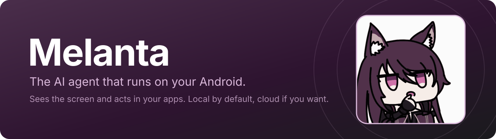
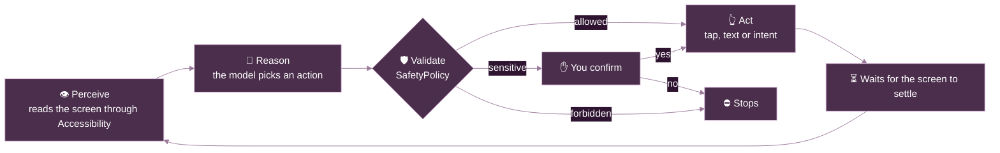

<p align="center">
  
</p>

<p align="center">
  
  
  
  
  <a href="LICENSE"></a>
</p>

<p align="center">
  <b>Ask in plain language. Melanta reads the screen, decides the next step and taps through your apps for you.</b><br>
  By default, the model runs on the phone itself, with no server and no account. If you prefer, turn on Cloud mode with your own API key.
</p>

---

## ✨ What it does

You write a request, the agent carries it out, and you follow along through a chip in the status bar. The app's interface is in Brazilian Portuguese, and these requests are the ones it is tested with:

| You ask | Melanta |
|---|---|
| *"Põe um alarme para 7h"* (set an alarm for 7) | Creates the alarm in Clock |
| *"Coloca um timer de 5 minutos"* (a 5-minute timer) | Starts the timer |
| *"Desliga o wi-fi"* (turn off Wi-Fi) | Opens the panel and turns off the switch |
| *"Manda SMS para 11 99999-8888 dizendo oi"* (text this number) | Writes the message and **asks you to confirm** before sending |
| *"Crie um contato com nome Jose e o número +55 24 98777-8990"* (add a contact) | Fills in the form and saves it |
| *"Me leva até a Avenida Paulista"* (take me there) | Opens the route in Maps |
| *"Liga para 11 98765-4321"* (call this number) | Opens the dialer; you place the call yourself |

It also opens apps and links, searches the web, drafts WhatsApp messages and emails, and creates calendar events. In other apps, it navigates the screen by tapping, typing and scrolling.

## 🔒 Privacy

Melanta has two modes. **Local** is the default, and **Cloud** only turns on if you ask for it.

| | 📱 Local | ☁️ Cloud (optional) |
|---|---|---|
| **Where the AI runs** | On the device, with [LiteRT-LM](https://github.com/google-ai-edge/LiteRT-LM) | At the provider you choose, with your API key |
| **What leaves the device** | Nothing from your screen | Your request, the text on screen and the actions taken so far |
| **Internet** | Only to download the model | At every step of the task |
| **Cost** | None | Whatever the provider charges your account |

Actions such as a web search or opening a link use the apps on the phone, which access the internet as usual. The log of each run stays on the device, in `files/agent-logs`.

**In Cloud mode:**

- **You authorize each destination.** A notice explains what will be sent, and nothing leaves without your approval. Switching provider or address asks again.
- **The key is encrypted on the device** with the Android Keystore, and is only used with the destination it was saved for.
- **Content is reduced before sending.** Password fields are hidden, and long numbers, emails and codes are masked. Notification text is only sent if you turn that on. Screens from banking apps and password managers are not sent.
- **HTTPS only.** Redirects are not followed, so the screen and the key cannot end up on another server.
- **It stays visible.** The floating button and the notification show ☁ while a task runs in the cloud.

> [!WARNING]
> The content reduction is automatic and can miss things. Names and messages visible on screen are sent, and what happens to the data afterwards depends on the provider's policy.

## 🛡️ Safety

Small models make mistakes, including in sensitive cases: in testing, all of them failed payment scenarios, and one sent a message to a number with an extra digit. That is why the rules below live **in the code**. They apply in both modes, and the model cannot ignore them.

| Rule | Examples |
|---|---|
| ⛔ **Always blocked** | Payments and purchases, banking, wallet and crypto apps, typing passwords, PINs or card numbers |
| 🎯 **Checks the destination** | A number or email that is not in the request, on screen or in a notification is rejected. If the request names a phone number, the message cannot go out from a conversation with a different number |
| ✋ **Asks for your confirmation** | Sending, deleting, calling, confirming, signing out. For SMS, WhatsApp and email forms opened by the agent, it shows the recipient and the text. With no answer within 60 s, the action is denied |
| 🙋 **Hands over to you** | Protected system windows the agent cannot read, such as permission prompts |
| ⏱️ **Limits per task** | 20 steps, 5 minutes, 3 repeats of the same action on the same screen, 3 errors in a row |

**To stop it right away:** the floating **PARAR** (stop) button, the action in the notification, or **Volume Down three times**.

## ⚙️ How it works

The agent repeats a short cycle until it finishes or hits a limit. The model, local or in the cloud, suggests the action, but the code is what authorizes and executes it.



The screen reaches the model as a compact list of elements:

```text
SCREEN (com.android.settings | Settings Panel):
[1] txt "Wi‑Fi"
[3] item "Wi‑Fi" click
[4] sw "Wi‑Fi" click checked
[9] btn "Done" click
```

And it answers with a single action in JSON:

```json
{"thought": "rule 5: tap the switch", "tool": "click", "args": {"id": 4}}
```

## 🧠 Models

### 📱 Local

All of them are free, Apache-2.0 licensed and need no login. The app handles the download, with resume and SHA-256 verification.

| Model | Size | Recommended RAM | Correct¹ | Speed¹ |
|---|---:|---:|---:|---:|
| **Gemma 4 E2B** (default) | 2.6 GB | 8 GB | **22/28** | 42 tok/s |
| Qwen3 4B Instruct 2507 | 2.7 GB | 12 GB | 18/28 | 11 tok/s |
| Qwen2.5 1.5B (light) | 1.6 GB | 6 GB | 8/28 | 27 tok/s |

<sub>¹ 28-scenario benchmark from <code>tools/model-bench</code>, run on a desktop CPU with 16 threads. Speed will differ on a phone.</sub>

### ☁️ Cloud

Use any provider compatible with the OpenAI API. The app includes presets for **Groq**, **OpenRouter**, **OpenAI** and **Google Gemini**, and you can enter another HTTPS address. To turn it on, open **⋮ → Motor de IA** (AI engine), save your key, test the connection and select **Nuvem** (Cloud). The model suggested by each preset can be changed.

## 📊 Current status

The project is in development and there is no published release yet.

| Item | Result |
|---|---|
| End-to-end tests (10 tasks, emulator, Gemma on CPU) | **8/10** in the latest run, averaging 35 s per task |
| Unit tests | 134 passing |
| Cloud mode on the emulator, with a fake provider | Task completed, content masked, clear messages for a wrong key and a provider outage |
| Telegram on a real phone | With a scripted fake provider, it searched for a group, opened it and sent a message |

**Known limitations**

- **SMS in the end-to-end tests:** the result varies between runs. It passed in the previous run and, in the latest one, the model wrote the value in the wrong format and then made up a number. The agent rejected it and nothing was sent.
- **Calendar event:** this task always fails on the test emulator, because Google Calendar has no Google account there and closes the editor.
- **Local model on a real phone:** a full Telegram task with Qwen2.5 1.5B, the weakest model in the catalog, failed. Gemma 4 E2B has not been tried on a phone yet.
- **Cloud mode:** Gemini answered during real tasks, but a long task has not been completed with a real provider yet, and the other presets and the quality of the answers are unmeasured. Servers on the local network over HTTP, such as Ollama, are not accepted; HTTPS is required.
- **Recipient by name:** the destination check covers numbers and emails. It does not confirm that the group or contact that was opened is the one you asked for, and the confirmation may not name it, so check the screen before approving.
- **Real phone:** Volume Down three times and GPU acceleration have not been validated on a device. The emulator only uses the CPU.
- **WhatsApp, email and long tasks:** these are not part of the end-to-end tests yet.
- **Apps that hide elements:** if an app does not expose a field to Accessibility, the agent cannot read it.

## 🚀 Getting started

**You will need:** the Android SDK with platform 37 and a JDK (the project is developed with JDK 27). The device needs Android 12 or later and room for the model, plus a weight cache of similar size.

```bash
git clone git@github.com:antonyguedes/melanta.git
cd melanta
./gradlew :app:installDebug
```

Then, on the device:

1. Open Melanta and grant the requested permissions, especially **Accessibility**.
2. Download a model on the **Modelos** (Models) screen.
3. Write a request and follow it through the status bar.

To use the cloud instead of a local model, skip step 2 and set up the provider in **⋮ → Motor de IA** (AI engine).

> [!TIP]
> To run the model on an emulator, start it with at least 6 GB of RAM and 8 cores: `-memory 6144 -cores 8`.

## 🧩 Project structure

```text
melanta
├── app                  Navigation, permissions, models and AI engine screens, playground
├── core
│   ├── ai               Local and cloud engines, models, prompt, action parser and content redactor
│   ├── automation       Accessibility service, screen reading, action and intent execution
│   ├── designsystem     Brand theme and components
│   └── common           Shared utilities
├── feature
│   └── agent            Agent loop, safety rules, overlay, notifications and main screen
└── tools
    ├── model-bench      Desktop model benchmark, with the same prompt and parser as the app
    └── e2e              End-to-end tests over adb and a fake provider for Cloud mode
```

**Built with:** Kotlin, Jetpack Compose, Hilt, Coroutines, WorkManager, DataStore and LiteRT-LM.

## 🧪 Testing

```bash
# Unit tests and lint
./gradlew testDebugUnitTest lintDebug

# End-to-end: needs the debug build installed, with the model on the device
python3 tools/e2e/run_e2e.py --serial emulator-5554
python3 tools/e2e/run_e2e.py --only alarme,wifi,sms

# Benchmark a model on the desktop
./gradlew :tools:model-bench:installDist
tools/model-bench/build/install/model-bench/bin/model-bench path/to/model.litertlm --threads 16

# The same scenarios against a provider (the key comes from the environment, never from an argument)
MELANTA_CLOUD_KEY=your-key tools/model-bench/build/install/model-bench/bin/model-bench \
  --cloud https://api.groq.com/openai/v1 --cloud-model llama-3.3-70b-versatile

# Fake provider, to test Cloud mode with no key and no cost (on the emulator: http://10.0.2.2:8123/v1)
python3 tools/e2e/fake_cloud.py --log bodies.jsonl
```

> [!NOTE]
> The end-to-end script looks for `adb` in `~/Android/Sdk/platform-tools/`. It also changes the device: it sends SMS, toggles Wi-Fi, deletes the `Jose` and `Maria` contacts and resets YouTube's notification permission. Use a dedicated emulator.

## 📄 License

The code is distributed under the [MIT license](LICENSE). © 2026 Antony Guedes.

The banner image shows Melantha, a character from *Arknights*, and is not covered by this license. The rights to the character belong to their respective owners.
