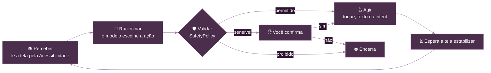

<p align="center">
  
</p>

<p align="center">
  
  
  
  
  <a href="LICENSE"></a>
</p>

<p align="center">
  <b>Peça em português. O Melanta lê a tela, decide o próximo passo e toca nos apps por você.</b><br>
  Por padrão, o modelo roda no próprio celular, sem servidor e sem conta. Se preferir, ligue o modo Nuvem com a sua chave de API.
</p>

---

## ✨ O que ele faz

Você escreve o pedido, o agente executa e você acompanha tudo por um chip na barra de status.

| Você pede | O Melanta faz |
|---|---|
| *"Põe um alarme para 7h"* | Cria o alarme no Relógio |
| *"Coloca um timer de 5 minutos"* | Inicia o timer |
| *"Desliga o wi-fi"* | Abre o painel e desliga o interruptor |
| *"Manda SMS para 11 99999-8888 dizendo oi"* | Escreve a mensagem e **pede sua confirmação** antes de enviar |
| *"Crie um contato com nome Jose e o número +55 24 98777-8990"* | Preenche o formulário e salva |
| *"Me leva até a Avenida Paulista"* | Abre a rota no Maps |
| *"Liga para 11 98765-4321"* | Abre o discador; quem completa a ligação é você |

Ele também abre apps e links, faz buscas na web, escreve no WhatsApp e por e-mail e cria eventos na agenda. Nos demais apps, navega pela tela com toques, digitação e rolagem.

## 🔒 Privacidade

O Melanta tem dois modos. O **Local** é o padrão, e o **Nuvem** só liga se você pedir.

| | 📱 Local | ☁️ Nuvem (opcional) |
|---|---|---|
| **Onde a IA roda** | No aparelho, com [LiteRT-LM](https://github.com/google-ai-edge/LiteRT-LM) | No provedor que você escolher, com a sua chave de API |
| **O que sai do aparelho** | Nada da sua tela | Seu pedido, os textos da tela e as ações feitas até ali |
| **Internet** | Só para baixar o modelo | A cada passo da tarefa |
| **Custo** | Nenhum | O que o provedor cobrar na sua conta |

Ações como busca na web ou abrir um link usam os apps do próprio celular, que acessam a internet normalmente. Os logs de cada execução ficam no aparelho, em `files/agent-logs`.

**No modo Nuvem:**

- **Você autoriza cada destino.** Um aviso explica o que será enviado, e nada sai sem esse aceite. Trocar de provedor ou de endereço pede autorização de novo.
- **A chave fica cifrada no aparelho**, com o Android Keystore, e só é usada no destino para o qual foi salva.
- **O conteúdo é reduzido antes do envio.** Campos de senha são ocultados, e números longos, e-mails e códigos são mascarados. O texto das notificações só vai se você ativar. Telas de bancos e de gerenciadores de senha não são enviadas.
- **Só HTTPS.** Redirecionamentos não são seguidos, para a tela e a chave não irem parar em outro servidor.
- **Fica visível.** O botão flutuante e a notificação mostram ☁ enquanto a tarefa roda na nuvem.

> [!WARNING]
> A redução de conteúdo é automática e pode deixar passar algo. Nomes e mensagens visíveis na tela são enviados, e o que acontece com os dados depois depende da política do provedor.

## 🛡️ Segurança

Modelos pequenos erram, inclusive em casos sensíveis: nos testes, todos falharam em cenários de pagamento. Por isso, as regras abaixo estão **no código**, valem nos dois modos e o modelo não consegue ignorá-las.

| Regra | Exemplos |
|---|---|
| ⛔ **Bloqueado sempre** | Pagamentos e compras, apps de banco, carteiras e cripto, digitar senhas, PINs ou números de cartão |
| 🎯 **Confere o destino** | Número ou e-mail que não está no pedido, na tela ou em uma notificação é recusado. Se o pedido cita um telefone, a mensagem não sai de uma conversa com outro número |
| ✋ **Pede sua confirmação** | Enviar, excluir, ligar, confirmar, sair da conta. No envio, mostra o destinatário e o texto. Sem resposta em 60 s, a ação é negada |
| 🙋 **Passa a vez para você** | Janelas protegidas do sistema, como pedidos de permissão, que o agente não consegue ler |
| ⏱️ **Limites por tarefa** | 20 passos, 5 minutos, 3 repetições da mesma ação na mesma tela, 3 erros seguidos |

**Para parar na hora:** botão **PARAR** flutuante, ação na notificação ou **Volume− três vezes**.

## ⚙️ Como funciona

O agente repete um ciclo curto até concluir ou atingir um limite. O modelo, local ou na nuvem, sugere a ação, mas quem autoriza e executa é o código.



A tela chega ao modelo como uma lista compacta de elementos:

```text
SCREEN (com.android.settings | Settings Panel):
[1] txt "Wi‑Fi"
[3] item "Wi‑Fi" click
[4] sw "Wi‑Fi" click checked
[9] btn "Done" click
```

E ele responde com uma única ação em JSON:

```json
{"thought": "rule 5: tocar no interruptor", "tool": "click", "args": {"id": 4}}
```

## 🧠 Modelos

### 📱 Local

Todos são gratuitos, têm licença Apache-2.0 e não exigem login. O download é feito pelo app, com retomada e conferência de SHA-256.

| Modelo | Tamanho | RAM recomendada | Acertos¹ | Velocidade¹ |
|---|---:|---:|---:|---:|
| **Gemma 4 E2B** (padrão) | 2,6 GB | 8 GB | **22/28** | 42 tok/s |
| Qwen3 4B Instruct 2507 | 2,7 GB | 12 GB | 18/28 | 11 tok/s |
| Qwen2.5 1.5B (leve) | 1,6 GB | 6 GB | 8/28 | 27 tok/s |

<sub>¹ Benchmark de 28 cenários do <code>tools/model-bench</code>, rodado em CPU de desktop com 16 threads. Num celular, a velocidade será diferente.</sub>

### ☁️ Nuvem

Use qualquer provedor compatível com a API da OpenAI. O app já traz presets de **Groq**, **OpenRouter**, **OpenAI** e **Google Gemini**, e você pode informar outro endereço HTTPS. Para ligar, abra **⋮ → Motor de IA**, salve a chave, teste a conexão e selecione **Nuvem**. O modelo sugerido em cada preset pode ser trocado.

## 📊 Estado atual

O projeto está em desenvolvimento e ainda não há versão publicada.

| Item | Resultado |
|---|---|
| Testes de ponta a ponta (10 tarefas, emulador, Gemma em CPU) | **9/10**, média de 22 s por tarefa |
| Testes unitários | 130 passando |
| Modo Nuvem no emulador, com um provedor falso | Tarefa concluída, conteúdo mascarado, chave errada e provedor fora do ar com mensagem clara |

**Limitações conhecidas**

- **Modo Nuvem:** ainda não foi testado com um provedor real, então os presets e a qualidade das respostas não estão medidos. Servidores na rede local por HTTP, como Ollama, não são aceitos; é preciso HTTPS.
- **Destinatário por nome:** a conferência de destino vale para números e e-mails. Ao pedir "manda para a Ana", confira o destinatário na confirmação.
- **Evento na agenda:** é a tarefa que falta no E2E. O Google Agenda do emulador de teste não tem conta Google e fecha o editor.
- **Celular real:** Volume− três vezes e aceleração por GPU ainda não foram validados em um aparelho. O emulador usa só a CPU.
- **WhatsApp, e-mail e tarefas longas:** ainda não fazem parte do E2E.
- **Apps que escondem elementos:** se um app não expõe um campo à Acessibilidade, o agente não consegue lê-lo.

## 🚀 Como rodar

**Você precisa de:** Android SDK com a plataforma 37 e JDK (o projeto é desenvolvido com o JDK 27). O aparelho precisa de Android 12 ou superior e de espaço para o modelo, mais um cache de pesos de tamanho parecido.

```bash
git clone git@github.com:antonyguedes/melanta.git
cd melanta
./gradlew :app:installDebug
```

Depois, no aparelho:

1. Abra o Melanta e conceda as permissões pedidas, principalmente a **Acessibilidade**.
2. Baixe um modelo na tela de **Modelos**.
3. Escreva um pedido e acompanhe pela barra de status.

Para usar a nuvem no lugar do modelo local, pule o passo 2 e configure o provedor em **⋮ → Motor de IA**.

> [!TIP]
> Para rodar o modelo em um emulador, inicie-o com pelo menos 6 GB de RAM e 8 núcleos: `-memory 6144 -cores 8`.

## 🧩 Estrutura

```text
melanta
├── app                  Navegação, permissões, telas de modelos e de motor de IA, playground
├── core
│   ├── ai               Motores local e na nuvem, modelos, prompt, parser de ações e redator de conteúdo
│   ├── automation       Serviço de Acessibilidade, leitura da tela, execução de ações e intents
│   ├── designsystem     Tema e componentes da marca
│   └── common           Utilitários compartilhados
├── feature
│   └── agent            Loop do agente, regras de segurança, overlay, notificações e tela principal
└── tools
    ├── model-bench      Benchmark de modelos no desktop, com o mesmo prompt e parser do app
    └── e2e              Testes de ponta a ponta via adb e provedor falso para o modo Nuvem
```

**Tecnologias:** Kotlin, Jetpack Compose, Hilt, Coroutines, WorkManager, DataStore e LiteRT-LM.

## 🧪 Testes

```bash
# Testes unitários e lint
./gradlew testDebugUnitTest lintDebug

# Ponta a ponta: exige o build de debug instalado, com o modelo no aparelho
python3 tools/e2e/run_e2e.py --serial emulator-5554
python3 tools/e2e/run_e2e.py --only alarme,wifi,sms

# Benchmark de um modelo no desktop
./gradlew :tools:model-bench:installDist
tools/model-bench/build/install/model-bench/bin/model-bench caminho/do/modelo.litertlm --threads 16

# Os mesmos cenários contra um provedor (a chave vem do ambiente, nunca de um argumento)
MELANTA_CLOUD_KEY=sua-chave tools/model-bench/build/install/model-bench/bin/model-bench \
  --cloud https://api.groq.com/openai/v1 --cloud-model llama-3.3-70b-versatile

# Provedor falso, para testar o modo Nuvem sem chave e sem custo (no emulador: http://10.0.2.2:8123/v1)
python3 tools/e2e/fake_cloud.py --log corpos.jsonl
```

> [!NOTE]
> O roteiro de E2E procura o `adb` em `~/Android/Sdk/platform-tools/`. Ele também altera o aparelho: envia SMS, muda o Wi-Fi, apaga os contatos `Jose` e `Maria` e redefine a permissão de notificações do YouTube. Use um emulador dedicado.

## 📄 Licença

O código é distribuído sob a [licença MIT](LICENSE). © 2026 Antony Guedes.

A imagem do banner mostra Melantha, personagem de *Arknights*, e não faz parte dessa licença. Os direitos da personagem pertencem aos seus detentores.
